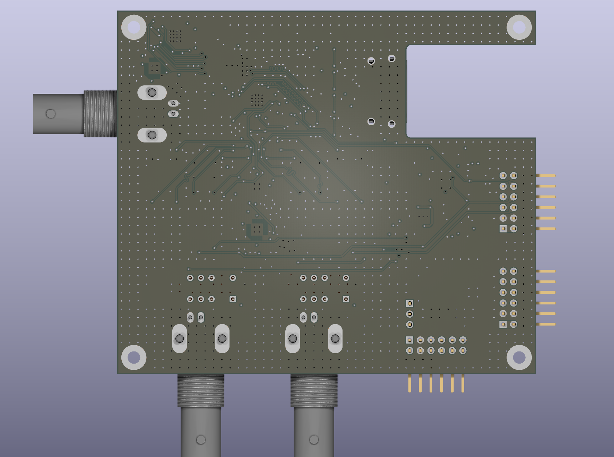
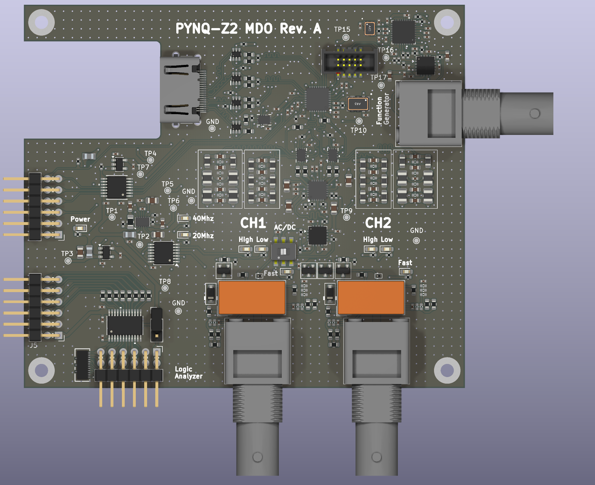
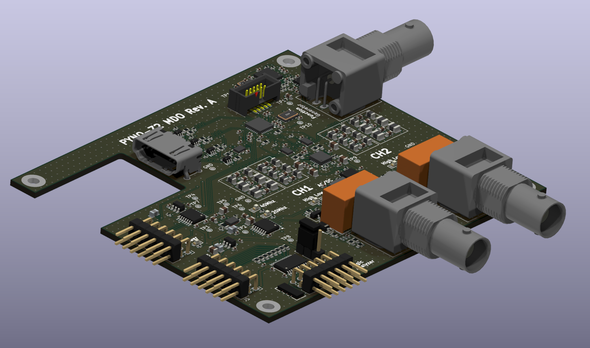
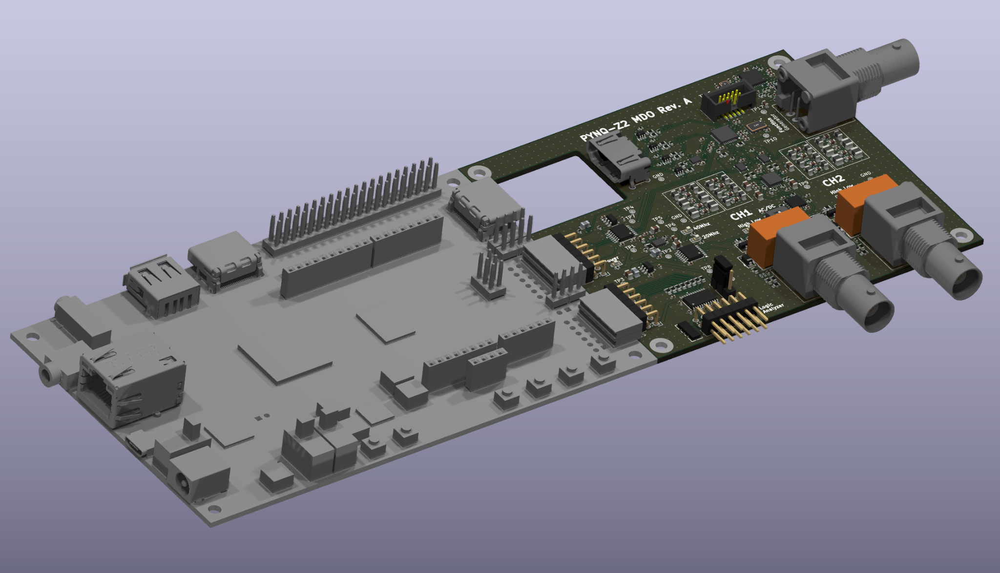

# PCB Layout

The oscilloscope is implemented as a four-layer mixed-signal PCB designed around the PYNQ-Z2 mechanical and electrical interface.

## Board views

  
  

  
  

## Final manufacturing specification

The finalized Rev. A PCB is a four-layer nominal 1.6 mm JLCPCB **JLC04161H-7628** standard board, FR4 Tg135, 1 oz outer/0.5 oz inner, ENIG 1 µin, **without purchased controlled-impedance service**. The selected published geometry is a modeling reference; it does not imply that impedance was ordered or guaranteed. In1.Cu is the broad GND reference plane and In2.Cu carries power pours plus 431 routed segments. See [current fabrication and simulation closeout](../verification/si_pi/JLC04161H-7628_final_20261022.md).

## Layer structure

The four-layer layout uses front copper for component fanout and critical local routing, a continuous inner ground/reference plane, an inner power/secondary-routing layer and back copper for auxiliary routing. Critical high-speed paths are kept over continuous reference regions.

## Analog placement

The two acquisition channels use closely matched physical structures. Attenuation, amplification, filtering and differential-drive sections follow the signal direction from the BNC connectors toward the ADC.

The ADA4927-2-to-AD9655 interconnect is short and symmetric to limit parasitic imbalance at the converter input. Local ground stitching is concentrated around the analog channels, filter sections, converter and high-speed amplifiers.

## Digital routing

The AD9655 source-synchronous interface routes toward the FPGA connector with controlled differential geometry and pair matching. DCO/FCO, data lanes and converter-clock routes are treated as timing-critical interconnects.

## Power layout

Power conversion and regulation occupy dedicated regions away from the analog BNC inputs. Local decoupling is concentrated around the ADC, high-speed amplifiers, clock circuitry, logic translation and AD9102 subsystem.

## Mechanical integration

The board outline follows the PYNQ-Z2 connector and mounting geometry while preserving access to the three BNCs, headers, test points and mounting holes.

The fabrication package uses the final Rev. A board geometry. PCB checks report **0 DRC violations, 0 unconnected pads and 0 footprint errors**, while the schematic ERC reports **0 errors and 0 warnings**.
