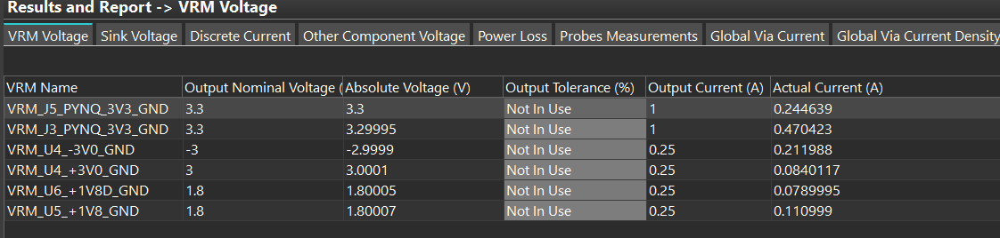
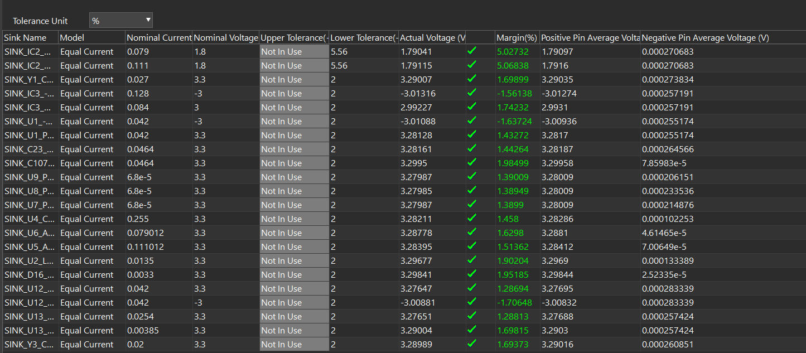
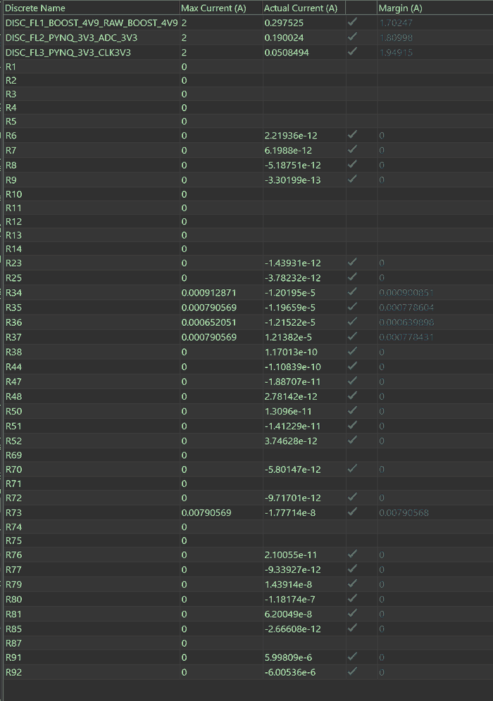
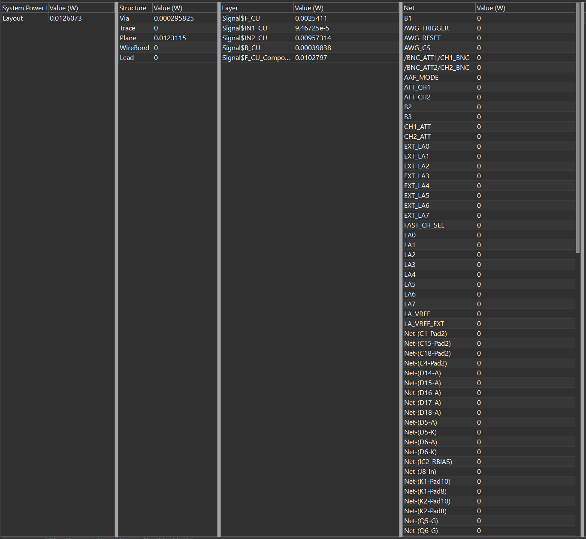

# Signal and Power Integrity

This page summarizes the Rev. A post-layout SI and board-power results.

## Current final manufacturing reference — October 22, 2026

The finalized board uses **JLC04161H-7628, standard four-layer 1.6 mm (FR4 Tg135), 1 oz outer/0.5 oz inner, ENIG 1 µin**. **No controlled-impedance service is ordered.** The JLC-published geometry is 0.035 / 0.2104 / 0.0152 / 1.065 / 0.0152 / 0.2104 / 0.035 mm, copper and dielectrics from top to bottom. Its nominal conductor/dielectric total is 1.5862 mm, excluding mask. Published 7628/core Dk is 4.4/4.6. See [current final stackup and SI/PI reconciliation](../verification/si_pi/JLC04161H-7628_final_20261022.md) and [JLC's published table](https://jlcpcb.com/impedance). Actual impedance should be extracted, not presented as fabrication-controlled.

**The September stack below is preserved as a historical PowerSI model only, and is not the October manufactured-stack signoff.** The current imported SPD has a 25.4× noncopper unit error and its PowerSI/PowerDC assignments must be rebuilt on the final geometry. Existing historical result figures remain historical; hardware and manufacturing outputs are unchanged.

## Historical September PowerSI reference structure

The four-layer PCB uses the following physical stack in the PowerSI model:

| Layer | Thickness |
|---|---:|
| F.Mask | 10.0000 um |
| F.Cu | 34.2646 um |
| dielectric 1 | 100.0000 um |
| In1.Cu | 17.1323 um |
| dielectric 2 | 1275.0000 um |
| In2.Cu | 17.1323 um |
| dielectric 3 | 100.0000 um |
| B.Cu | 34.2646 um |
| B.Mask | 10.0000 um |
| **Total** | **1597.7938 um** |

Critical high-speed routing is referenced to continuous ground structure where possible. The main analysis targets are the FDA-to-ADC analog differential paths, AD9655 source-synchronous digital interface, DCO, FAST/AUX switching path, PYNQ connector transition and clock paths.

## PowerSI

The completed passive-SI campaign contains **12 result sets** spanning the upstream ADC interface, post-switch digital paths, clocks, analog frontend/post-ADC networks and AWG interconnects.

The focused D1B/J9 extraction uses six physical ports at IC2, U9 and J9. Its S6P contains **4005 points from 1 MHz to 10 GHz**, with numerical reciprocity of approximately `7.1e-15` and maximum singular value `0.999999324`.

At 500 MHz:

- IC2 to U9 differential transmission: **-3.808 dB**
- IC2 to J9 differential transmission: **-3.278 dB**
- J9 P/N skew: **29.7 ps**
- J9 differential-to-common conversion: **-29.1 dB**

The approximately 3.5 dB branch level is dominated by the expected three-port tee split rather than trace dissipation.

`verification/si_pi/POWERSI_26PORT_VALIDATION.txt` and `POWERSI_26PORT_SETUP.txt` retain the detailed upstream interface setup information.

## PowerDC

The board-power model was solved after the AWG and local power architecture were finalized. The load model includes:

- AD9655 converter loads
- clock rails
- AFE and switch loads
- TPS61033 boost stage
- LM27762 bipolar analog rails
- AD9102: **30 mA** from PYNQ_3V3
- 125 MHz LVDS oscillator: **27 mA** from CLK3V3
- ADA4817-2 AWG output stage: **22 mA** device current
- LM27762-equivalent CP_3V3 input load: **0.277 A**
- -2V0 output load: **0.192 A**
- +3V0 output load: **0.084 A**

The solved result set includes regulator voltage, sink voltage, discrete-current and board conductive-loss views. Original captures are stored under `docs/assets/powerdc/`.

  

  

  
  

## Hardware measurements after fabrication

Physical characterization will cover rail accuracy and ripple, startup sequencing, clock amplitude/jitter, ADC timing margin, FFT/noise-floor behavior, simultaneous acquisition plus AWG operation and sustained-load thermal behavior.
